# 学习主题与 OpenMAIC 薄接入

基线：main `e2d9cd83a176bf2fc6b35bc1dabe7f92f32bc9d6`。分支：`codex/learning-openmaic`。
验证日期：2026-10-19 至 2026-10-20。仅合成资料；未安装到用户正在运行的开图或 DSH。已补真实 DSH SDK、真实 ACP CLI 与一次本机 Qwen 流程，具体范围见末节。

## 实现范围

- 资讯「开始学习」把标题、来源链接和已有摘要带入保存表单，可归入已有主题；资料页可新建主题、粘贴材料。
- 来源放既有 `learning/<topic>/sources/*.md`；完全相同材料去重，追加材料不覆盖既有状态和笔记。
- 理解、未解问题、下一步按时间追加到 `notes.md`。下一步复用 STATUS 的 `next`；只有用户明确选择才完成旧条目，不推算掌握度。
- 接续按钮把主题指向和教学约束送入问问草稿，发送前可编辑。模型从同一主题的来源、笔记、下一步接上。
- `kaitu_learning` 提供 list/read/start/save；学习 skill 采用 OpenMAIC 一次一问、3–6 小步、先尝试再提示、用学习者原话总结的流程。
- 复用 OpenMAIC 的概念卡、自判小测、互动模拟 UI 和元数据；原始 MIT 许可证及 commit 在 `packages/core/src/learning-openmaic/`。工具名用 kaitu_learning_card/widget，避免与用户已安装插件冲突。
- 独立问问从既有对话工具结果加载 `/api/ask/teaching-frame`。单独响应使用 CSP 与 sandbox allow-scripts，阻止 workspace API 访问、表单和网络连接；主页面策略未放宽。DSH 原生会话用同一组件的 srcDoc。
- 沿用现有 Markdown 与 STATUS schema，无 schema 改动、无新课堂服务、无题库或新 session 持久协议。PPT 没有打包新 SDK，仅明确要求且工具可用时可调用已安装的 openmaic_slide。

## 验证结果与边界

- core/channels/cli TypeScript 编译、插件 host/client 类型与两个 UI 构建通过。
- 9 个针对性测试文件、29 个测试通过：DSH Remote 生成契约与后台版本、新学习文件读写、来源去重与 slug 碰撞保护、取消/超限、教学 metadata、受限 HTTP 帧，以及既有工具、skill、HTTP/SSE、ACP 会话回归。
- Computer Use 在隔离工作区验证：资讯 → 保存主题/来源 → 接续问问草稿 → 固定样例提问 → 回答后展示小测/模拟 → 手填理解/问题/下一步 → 重载后读回。
- 实际点击「11 元」显示正确反馈；模拟从第 2 期调到第 3 期显示 133.10 元。卡片从持久对话元数据重开可见，交互状态会重置。
- 这些结果证明本地链路与渲染可用，**不代表真实模型教学质量、真实模型自动保存、用户 DSH 新分支安装或 PPT 已验收**。原插件的用户亲测成功与本分支验收分开。
- 无模型时可手填并保存来源与学习记录。使用 AI 时材料由当前选定模型读取，不会另行自动发给 open.maic.chat。
- 所有构建直接用现有依赖；新增的 dev 类型引用 dsh-client-ui-tool@0.2.1-rc.2 复用本机已有包和锁文件条目，没有执行 npm/pnpm 安装。

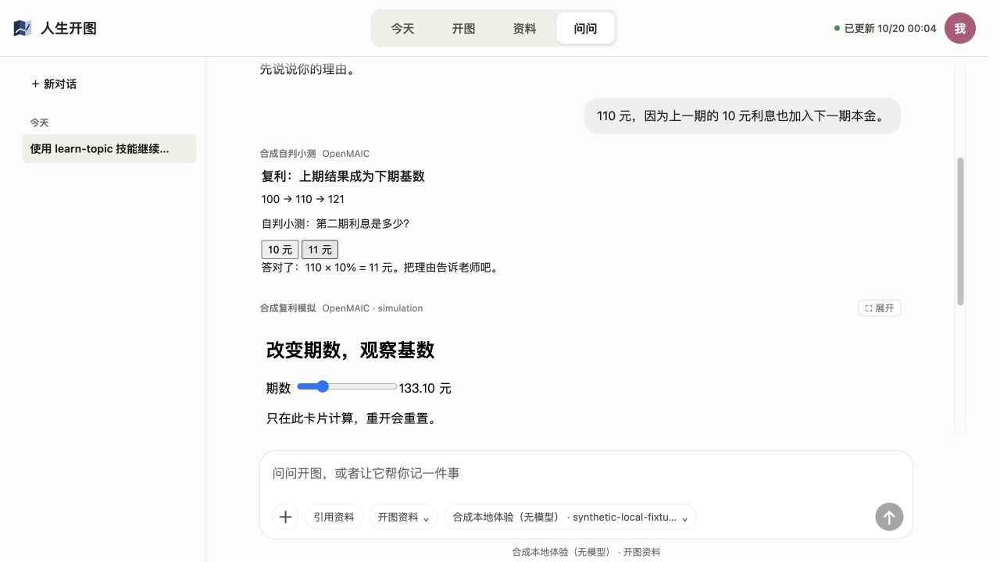

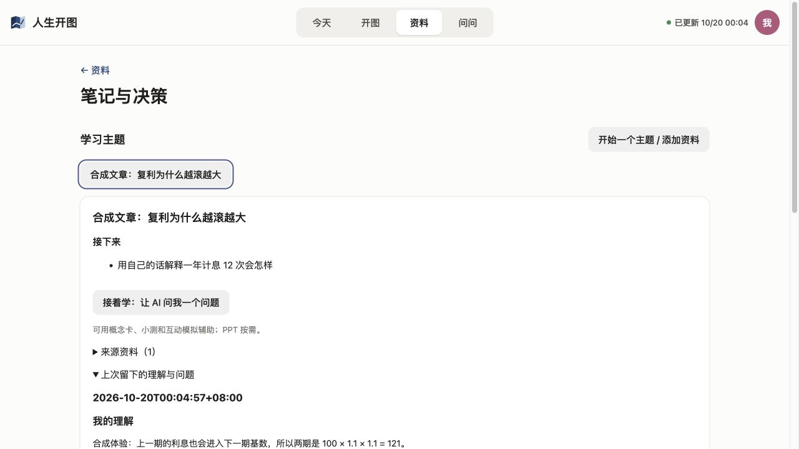

## 合成大工作区延迟

本机 Node 26，1000 个主题、1000 份既有笔记（每份 100 行）、1000 份来源（每份 500 行）。
20 次 localhost HTTP 读取/保存；后台版本写入沿用已有调度。

| 操作 | 结果 |
|---|---:|
| 构造 3000 个合成文件 | 615.6ms |
| startUi 返回 | 6.5ms |
| 第一次主题列表 | 152.0ms |
| 单主题读取 P50 / P95 | 1.9 / 4.6ms |
| 追加理解与下一步 P50 / P95 | 3.6 / 7.0ms |

这不是完整 App 冷启动或云盘下载基准。按钮按下立即显示保存中；UI 的交互体感通过上述浏览器操作核对。

## 用户亲测五个动作

1. 找一篇你真的想学的资讯，点「开始学习」，看来源和摘要是否带对；选择已有主题或建一个主题。
2. 点「接着学」发送草稿。故意答错或说不会，看它是否只给一个提示、能否等你回答，别只看生成材料漂不漂亮。
3. 要一个小测或模拟，操作一次，再把理由告诉 AI；确认 AI 没有假装已经看到卡片里的答案。
4. 用自己的话留一条理解、一条没懂的问题和一个很小的下一步；看今天页是否出现该动作，不把看完算作学会。
5. 关掉再开，从资料里回到同一主题，看它能否读到上次的问题并接着问。PPT 只在你明确需要时另试。

## PR 审查后的五项修复

| 问题 | 最小处理 | 回归证据 |
|---|---|---|
| 旧 STATUS 简写在详情被拒绝 | 与校验器、列表一样先 normalizeStatus；正文保留 | learning.test.ts 的无 updated / next 字符串旧文档可读、添资料、保存 |
| 已保存但响应丢失后重试重复总结 / 完成报错 | 新 save API 要求 operationId；界面同一未确认请求重用 ID，本地 `.kaitu/cache/learning-operations/<hash>.json` 记 topic 与输入 hash；完成回执先于下一步检查 | 跨 Workspace 重开重试不追加，换 ID 可记录相同理解；同 ID 换内容拒绝 |
| 保存 A 期间切 B 导致迟到响应覆盖 | 保存中锁主题切换、编辑、接续与取消；组件卸载后忽略写回本地 UI | 挂起服务桩下 B 与编辑框 disabled，释放保存后可编辑 B |
| 另一 Agent 保留 id 但改任务标题，旧界面误完成 | 完成须同时提交已读的 completedNextTitle；当前标题/status 不符则拒绝；重读主题保留本次输入 | 改名后旧提交失败，状态与笔记未变化 |
| 同主题同文字二次接续无草稿 | Overview 每次点击增加 promptRequest；独立 AskPage 和原生 PluginAsk 都接收该动作 | 实际独立页发送→回主题→再接续恢复草稿；原生适配器服务桩清空→再点击注入次数 1→2 |

操作回执是本机可丢弃的缓存，不是学习资料格式；不改 STATUS、notes 或来源 schema，不同步到第二台设备。
只保障已完成且回执仍在的同一次请求重试；不宣称多文件写入具有崩溃事务语义。另一次学习必须用新 ID，不按内容做全局去重。

## 运行环境与能力边界

| 环境 | OpenMAIC 插件未安装 | OpenMAIC 插件已安装 |
|---|---|---|
| 安装本分支开图插件的 DSH 原生会话 | 开图自带 kaitu_learning 和 card/widget；来源、保存、接续及教学卡片不依赖上游插件；无 PPT 工具则文字教学 | 在**同一 DSH profile** 安装时，开图的独立工具名不会覆盖上游；用户明确要求且会话列出 openmaic_slide 时可选 PPT |
| Kaitu.app / CLI-Web 内置 DSH（含自带登录或用户配置的外部 API 服务商） | 构建产物自带开图 SDK 插件和复用的 UI；card/widget 从已有工具元数据呈现。默认不打包 OpenMAIC SDK/课堂/PPT | 用户在另一个 DeepSeek Harness App 装插件，不会自动进入开图隔离的 DSH profile；本次能力与左列相同，不因此声称 PPT 可用 |
| 外部本机 Agent 的 ACP 模式（choice=local） | ACP 会话只注入现有开图 MCP；目前 MCP 无 kaitu_learning/card/widget，ACP 适配器也不传教学 meta。提示改为读技能/主题文件、文字练习；若该 Agent 有文件写权限，可写现有 Markdown，否则用户回资料页手填 | 装在 DSH 的 OpenMAIC 不会自动进入 ACP Agent。此 PR 不新增 ACP 卡片或 MCP 教学协议，行为同左列 |

“外部 API 服务商”仍走内置 DSH；“外部 ACP Agent”是不同运行时，不应混称。
源码依据：`packages/dsh-plugin/src/tools.ts`、`learning-tools.ts`、`client/index.tsx`、`packages/desktop/sdk-runtime.mjs`、`packages/cli/runtime/service.mjs`、`local-agents/runtime.ts`、`mcp/server.ts`。
以上模式边界来自源码和运行验证。真实 DSH / ACP 补验见末节；未使用用户付费账号或用户正在运行的 DSH 安装，教学质量仍需用户体验。

## 可复现的独立合成验收

前置：仓库依赖已就绪。这次只复用现有依赖，没有 npm/pnpm 安装。先生成本分支构建产物：

```sh
node node_modules/typescript/bin/tsc -p packages/core/tsconfig.json
node node_modules/typescript/bin/tsc -p packages/channels/tsconfig.json
node node_modules/typescript/bin/tsc -p packages/cli/tsconfig.json
node packages/dsh-plugin/scripts/build.mjs
node scripts/learning-smoke.mjs --check
```

`--check` 在全新临时目录中自动走来源保存、固定问答事件、受限教学帧、保存与同 ID 重试、重开读取，输出 PASS 后清理。
它不证明浏览器执行 JS 或真实模型理解，仅验证本地 HTTP/文件/元数据链路。

浏览器体验：运行 `node scripts/learning-smoke.mjs --port 4890`，打开输出的 URL。
该脚本只生成合成工作区和固定回复，不启动真实 AI Runtime、不读取用户资料或模型配置；Ctrl+C 清理。
使用 `scripts/fixtures/learning-openmaic.json` 中的标题、回答与 checkin，按上面的五个动作操作。
第一次问问若出现自动任务引导，选「都不要」。同主题二次接续额外步骤：发送草稿后回资料→笔记与决策→原主题→再次「接着学」，应再次填入同一文字，而非空草稿。

竞态与原生草稿桩页：运行 `node scripts/learning-ui-smoke.mjs` 并打开输出 URL。
输入 A 的理解→保存但不点「完成挂起保存」，核对 B 和编辑框禁用；完成挂起保存后再切 B，B 输入可正常编辑。
下方是实际 PluginAsk 组件配合合成会话服务：先清空草稿，再点「再次接着学（相同文字）」，草稿恢复、注入次数增加。
这是适配器逻辑回归，不是原生 DSH App 的真人验收；Ctrl+C 清理构建临时目录。

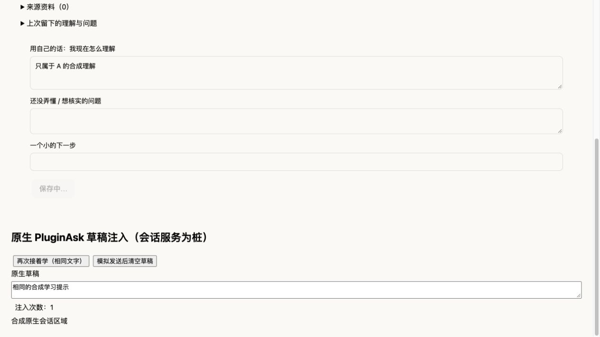

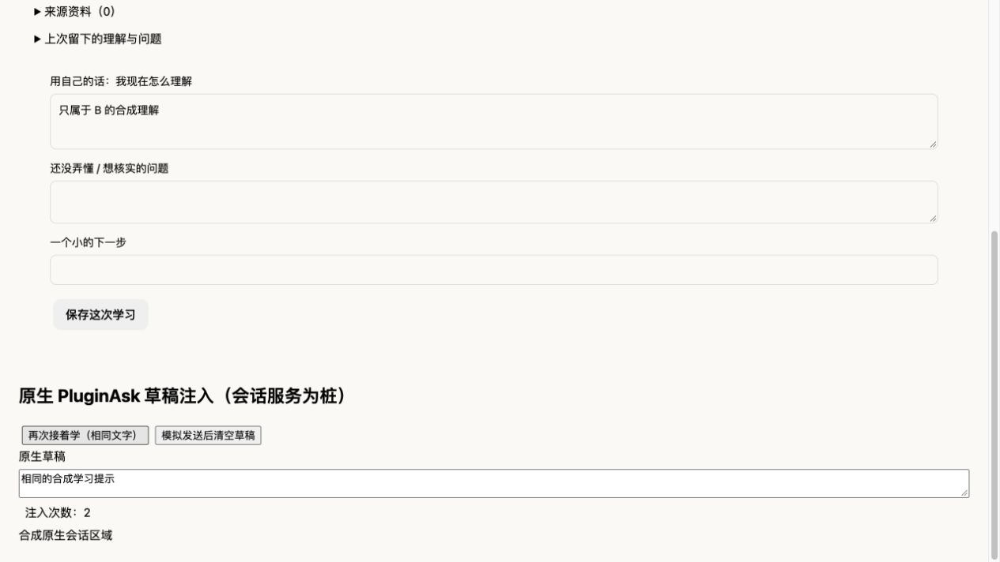

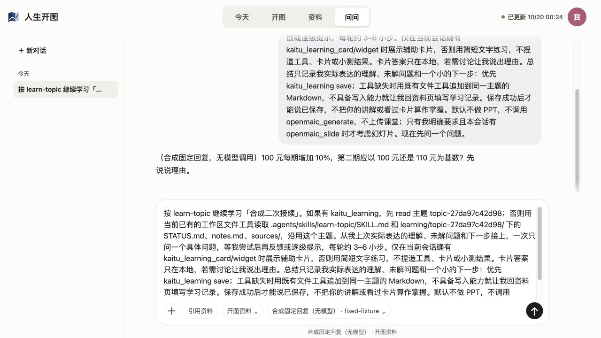

## 真实运行时补验（2026-10-19 UTC）

- 内置 DSH：使用仓库自带 Node 版 0.2.1-rc.2 引擎、实际 SDK 插件和真实工具执行，以本机受控 OpenAI HTTP 响应提供固定工具请求。read → card/widget → save → 关闭并重开 Ask/UI → read 通过，共 10 个本机 HTTP 请求。不是直接注入 Ask 事件，也不算模型教学质量验收。浏览器从保存的会话重开小测，错答有提示、正确答案有反馈；模拟调到第 3 期显示 133.10 元。资料页读回相同理解、问题、下一步，再点接续可填入草稿。
- 外部 ACP：实际安装的 claude-agent-acp 0.55.0，独立 HOME / CLAUDE_CONFIG_DIR、明确列出的环境变量和本机受控 Anthropic HTTP 响应。通过实际 Kaitu MCP read_file 和 Claude 自有 Read / Write 保存同一 Markdown；重建 Ask/UI 后真实 session/load 可继续读取，共 14 个本机请求。无 kaitu_learning/card/widget 时使用文字反馈；没有把 DSH 卡片能力算进 ACP。首次 notes.md 尚不存在是预期空记录。
- 这次真实 ACP 发现内容块为 `{type:"content",content:{type:"text",text}}`，原问问详情显示为空。现转换成既有平面文本块；真实 CLI 的缺文件错误已在浏览器展开可见，已有适配器测试补了对应回归。接续提示及技能说明新主题可尚无 notes.md。
- 真实模型：Ollama 0.24.0 + 已存在的 qwen2.5:14b，无下载、无付费账号。通过真实 DSH 从合成来源提问 → 对学习者回答反馈 → 工具实际保存理解/问题/下一步 → 关闭重开后工具读回并从“连续复利为什么出现 e”接续，共 8 个本机模型端点请求。先前一次把 questions/next 写成数组、operationId 放错层，被校验拒绝且未写入；补充工具说明中的明确参数示例后重跑通过。首次大上下文耗时明显，曾在 180 秒内未完成；不能据此承诺响应速度、通用模型可靠性或 3–6 步教学质量。
- 未通过路线：真实 Claude ACP CLI 接本机 Qwen 的首轮，在 330 秒内未完成；验收脚本超时终止了该 CLI 和本机代理请求。不能据受控响应链路宣称 ACP 真实模型的自动保存或完整教学已通过。原生 DSH App 中安装本分支、PPT 与用户付费模型也未验收。
- 本轮改动的 CLI 类型检查、插件与引擎构建、Biome（506 文件）通过；本机 Agent 回归 8 项、core 学习 5 项、插件 16 项、学习 HTTP 2 项通过。HTTP 两项初跑受沙箱 localhost 监听权限阻止，获准本机监听后复跑通过；未把权限失败说成产品回归，也未把上一轮全量 286 项称为本轮重跑。
- 父线程独立 Linux 动态 QA：准确 SHA `929d7fc85ea8fe7756519b593920cce2c0357bca`、Node 24.19，完整 build 通过；来源去重 → 保存并完成旧下一步 → 服务端 200 后丢响应使客户端 fetch failed → SIGKILL → 新 PID 重启 → 回读 → 同 operationId 并发重试均 replayed:true，notes / STATUS 字节不变；同 ID 改内容返回 400 且无写入。该检查没有浏览器或真实模型，不扩大为这些路线已验收。

重复运行真实运行时合成验收（构建后）：

```sh
node packages/cli/scripts/build-engine.mjs
node scripts/learning-runtime-smoke.mjs
node scripts/learning-acp-smoke.mjs /absolute/path/to/claude-agent-acp
```

ACP 命令只使用已安装 CLI，不安装依赖。两个脚本都使用临时合成工作区、本机固定响应、独立登录目录，不读取用户资料或登录，不产生模型推理费用。输出实际临时目录；可加 `--hold`，按最后输出的 URL 做浏览器回看，Ctrl+C 关闭。未把本机 Qwen 探索脚本纳入默认检查，避免隐式启动模型。

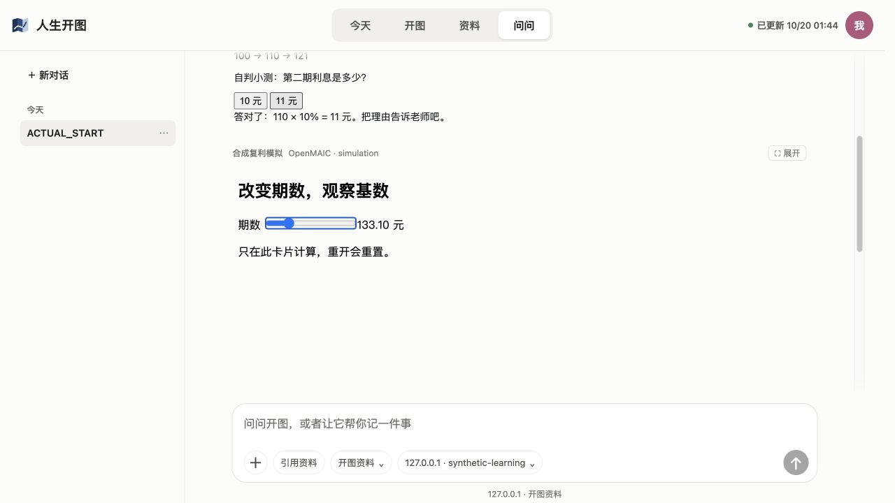

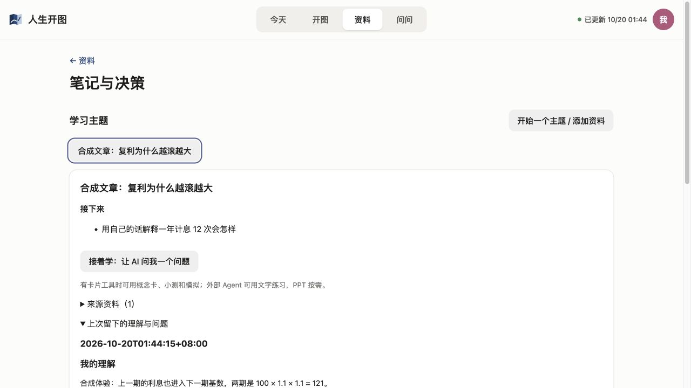

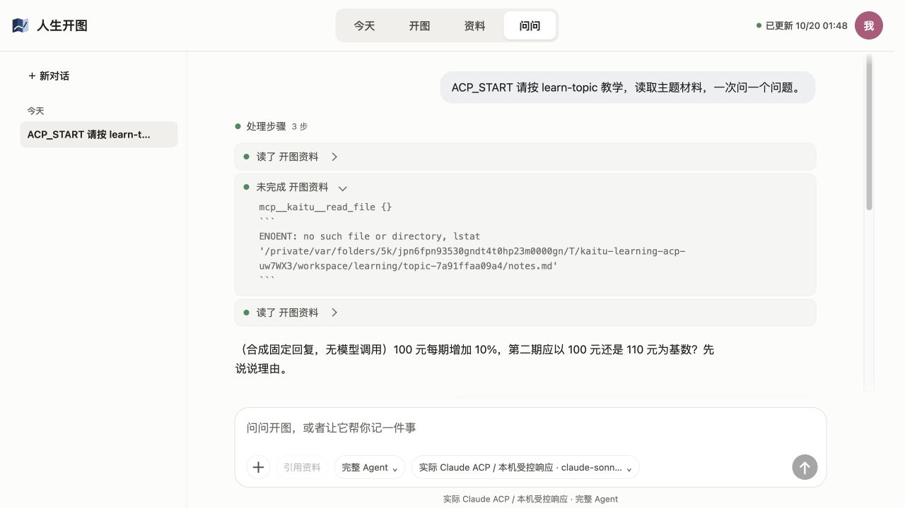


## Computer Use 真实学习流程（2026-10-20）

使用同一个临时合成工作区、实际 CLI-Web 界面、内置 DSH 0.2.1-rc.2 与已存在的本机 Ollama 0.24.0 / qwen2.5:14b。资料为 example.com 的合成复利摘要；全程未使用私人资料、付费账号、OpenMAIC 云端或用户现有 Harness profile。浏览器操作实际完成，模型回复来自本机推理。

- 资讯文章点「开始学习」携带标题、链接、已有摘要；保存后为一个主题、一个来源。重复从该文章开始并保存，仍是一个主题、一个来源。
- 首次接续得到模型问题；提交“100 元每期 10%，110 再 121”的实际回答后，模型给出相应反馈。返回资料，学习笔记仍为空，没有把 AI 讲解自动写成用户掌握。
- 资料页手填实际理解、疑问“连续复利为什么会出现 e？”和下一步“用自己的话解释一年计息12次与1次的区别”，保存成功。刷新后，今天显示相同下一步；资料页完整读回三项。此次 GUI 保存路径是手填表单，不据此宣称模型自动保存也已在 GUI 中通过。
- 首次模型把来源摘要说成“你上次提到的理解”。修复接续提示与 learn-topic 规则：空笔记按首次学习，明确区分来源、学习者原话和 AI 讲解。规则更新后同一运行时的新空笔记对话改称“根据现有的资料”，未再引用摘要为用户理解；仍有泛指“之前学习的主题记录”和同时给两个候选问题的瑕疵。随后补的 Start/开始学习开头通过构建，未为这处文字单独重跑新对话。
- 保存后，同一会话曾复用保存前的 read 结果，重复询问基础定义。修复为接续草稿附上本次打开时已读取的最近 4000 字符笔记和最多三个待推进标题，标明只是资料且可核对最新记录；不新增存储格式或运行时。
- 最终同一会话从资料页接续，草稿包含刚保存的理解、e 的疑问与待推进项；真实模型正确引用该理解并转向“连续复利为什么出现 e”，未再从基础定义重复开始。仍列了两个候选问题，因此只确认接续有效，未把严格一次一问判为通过。
- 本轮插件 host/client 与独立 UI 构建通过，相关学习/技能 2 文件 3 项回归、目标 Biome 与 git diff 检查通过。
- 本地模型首次大上下文和部分续轮等待较久，不能承诺响应速度或严格遵守一次一问。原生 DSH App 安装、PPT、ACP 真实模型完整教学仍未因本次浏览器验证而扩大为通过。


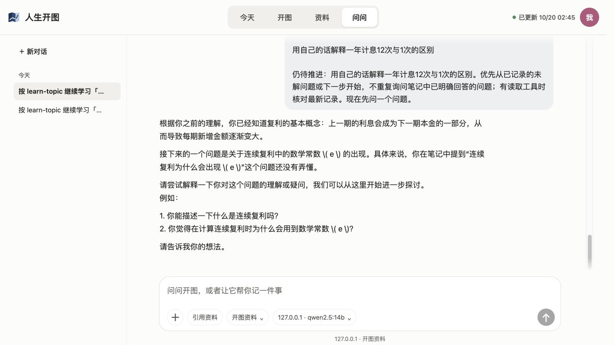


## 单问题、等待与取消收口（2026-10-20）

- 精确提交 `6d29fcd45b1c033594f297bbd095f9a00d7efca9` 的 [CI 39306913550](https://github.com/Stahl-G/rensheng-kaitu/actions/runs/39306913550)：macOS 成功；Windows lint/build/typecheck 成功，测试 279 通过、2 失败、7 跳过。失败仍为 ask-filesystem 的 FS_SANDBOX_DENIED 和 feishu 缺 lark-cli，属于既有 PR54 范围；没有新增学习失败。这不是后续提交的 CI 结果。
- “一次一问”原约束没有明确排除候选题列表。仅改现有中英文接续提示和技能：本条回复选一个具体问题、问完停、不列候选问题、不附加追问。相同合成主题、本机 Qwen 的实际接续回复只问“为什么连续复利会用到 e”；回答“不清楚，请问更小的问题”后，只问复利基本公式。此为两次观察，不承诺所有模型/对话均遵守；未增加输出过滤或重试模型框架。
- 单问题接续：发送至“停止”按钮可见约 284ms；等待中切到今天页并看到下一步约 398ms。另一次发送首反馈约 805ms。这些是含 Computer Use/浏览器自动化开销的单次观察，不当作浏览器渲染性能基准或普遍 0.3 秒承诺。
- 本机代理仅记录时间和请求大小，不记录凭据：约 82KB 工具/对话上下文的首轮，模型首文字 198.42 秒、模型请求总时长 204.85 秒；紧接小问题的首文字 1.68 秒、总时长 4.37 秒。等待时状态和导航正常，因此慢主要在本地推理首文字之前，未把它混称为应用页面阻塞。
- 实际点击“停止”发现 SDK 转发层未实现 session/cancel，原先报连接错误且继续运行。修复在 `packages/desktop/sdk-rpc.mjs`，调用固定版本原生 session controller 同样使用的 `ctx.agents.get(...).cancel({kind:"user"},{keepInbox:true})`；沿用 SDK 的 turn/end 和 idle 通知，不新建取消状态机。
- 修复后 GUI：模型请求已进入本机代理并开始输出，点击停止约 382ms 后恢复输入；代理出现 AbortError，SDK 记录 turn/end kind=aborted、reason.kind=user，随后 idle，无连接错误。另一次在首文字前取消约 276ms。没有把仅隐藏按钮算作中断成功。
- GUI 取消后，同一会话继续学习成功并只问复利基本公式；但随后直接给出了公式示例，没有严格等待学习者尝试。因此单问题数量有所改善，严格先答后提示仍是模型遵循限制，不继续堆叠提示或新增答案过滤。
- `scripts/learning-runtime-smoke.mjs` 增加真实 SDK 挂起请求→取消→服务端连接关闭→idle→再次接续回归，完整运行通过（13 个本机受控请求）。它验证真实入口和取消，不是模型推理；实际模型 GUI 另验。插件构建、引擎构建、相关 3 文件 6 项测试、目标 Biome 和 diff 检查通过。

### 原生 Harness 与可选幻灯片边界

- 当前安装 App 元数据版本为 0.2.1-rc.2；Computer Use 插件页显示 `@openmaic/dsh-openmaic` v0.4.0、启用、组件运行中。仅检查插件状态，没有向其在线模型发送合成或私人材料，没有切换其模型或改配置。
- 实际 installDsh 在独立临时 DSH_HOME 的 desktop profile 中连续安装两次，结果相同、受管段外文字保留、引用本分支构建产物；路径 `/tmp/kaitu-learning-native-profile-nqgvEW/profiles/desktop/cordis.patch.yml`。没有改真实 desktop profile。这证明安装入口，不代替真实 App 加载本分支后的 GUI 验收。第一次检查中误触 Workspace 构造的默认状态目录写入被沙箱阻止，随后用安装函数所需的 root 数据完成隔离检查，未申请写用户状态目录。
- 本分支原生客户端已注册 kaitu_learning_card/widget 的 toolview，问问通过 PluginAsk 复用 Harness 会话、输入和停止控件；保持既有调用方式。用户原有 App profile 没有加载这个开发分支，且原会话不是已授权本机模型路线，因此没有在那里发送请求。专用 native profile 的后续补验见下一节，不替换用户正在使用的 profile。
- 上游 `src/slide.ts` 的 openmaic_slide 接收模型写的本地 slide JSON，输出持久 meta；`src/client/SlideCard.tsx` 用已有 SlideCanvas 显示和展开。这是内联幻灯片，不等于导出 .pptx 文件；该路径本身不要求 open.maic.chat。完整 classroom 的 openmaic_generate 是另一条云端路径，本轮未调用。
- 本分支没有打包上游 SlideCanvas 或自行实现 PPT 框架；SDK 隔离 profile 没有 openmaic_slide，故可选入口仍是“明确要求且同会话已具备该工具”。未新增依赖或自动安装上游插件。尝试上游独立 slide 测试未返回结果，已终止，只算未完成，不能报告为测试成功。
- 期间系统曾报 ENOSPC，临时目录创建和日志缓存失败；仅清理本任务可重建的 Swift 模块缓存，之后空间恢复，隔离安装检查已完成。没有清理用户文件。原生 GUI/PPT 仍未验收，不以曾经磁盘不足代替当前具体边界。

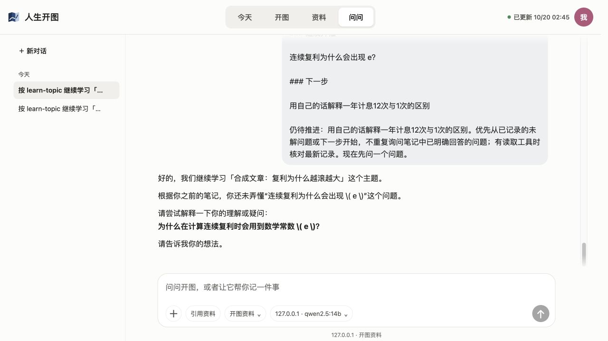

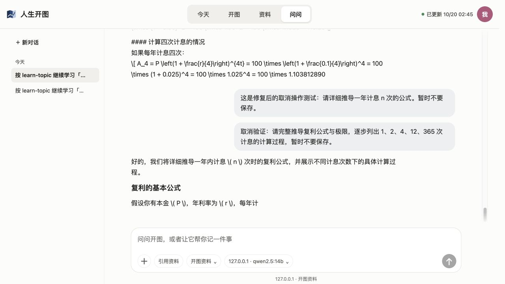


## 完整 Harness 隔离宿主补验（2026-10-20）

固定代码 `133d75b021547671e4813e85e0c44c9404e33db4` 的 [CI 39309103256](https://github.com/Stahl-G/rensheng-kaitu/actions/runs/39309103256) 已完成：macOS 成功，Windows 279 通过、2 失败、7 跳过，仍为同一 ask-filesystem / feishu 错误。使用已安装的官方 Harness 0.2.1-rc.2 可执行文件。DSH_HOME、Electron user-data-dir 和开图状态均指定本任务临时目录，插件指向当前分支 dist，本地模型仍为原 Ollama Qwen，不使用用户真实 profile、模型账号或私人材料。

- Computer Use 绑定原生 App 时返回的是用户原窗口，故没有在那里发送请求；改用该隔离原生进程实际提供的完整 Harness Web 客户端验证相同插件宿主与原生组件。不是 CLI-Web 的独立 AskPage，也不是合成会话桩；不据此声称 Electron 窗口本身已操作验收。
- 完整宿主中打开开图→资料→原学习主题，理解、e 的疑问、下一步、一个来源均读回；“接着学”进入 Harness 自有会话输入，正确带入最新笔记和单问题约束。本地模型菜单仅配置本地 Qwen，选择并实际发送。
- 首轮用时界面显示 3 分 50 秒，模型却给“检查工具是否存在”的命令说明，未提问。不能判作自然接续体验通过。补一句直接调用已提供 kaitu_learning read 的明确指令后，模型先传错参数，被校验拒绝，随后自行改为 `{action:"read",topic:"topic-7a91ffaa09a4"}`；展开真实工具结果可见 ok:true 及原笔记/来源/next，然后从 e 的疑问问出一个问题。此轮界面显示 32 秒。证明真实工具和客户端接入可用，但仍保留本地模型需要纠正、首轮偏离的体验限制。
- 停止隔离宿主并重启后，从 Harness 侧栏重新打开“复利与e的理解探讨”，真实对话及工具记录仍存在。没有将模型首次错误当成应用写入故障，也没有把其改正后的成功冒充首次即成功。
- 父线程独立 Linux QA 针对准确代码 `133d75b`：全量 build exit 0；真实 HTTP 来源→主题去重→保存后丢响应→SIGKILL→新 PID 回读→两次并发同 operationId 重试均 replayed 且无重复→同 ID 改内容 400 且文件不变，均通过。仅隔离合成数据，无模型/账号；不覆盖本节 GUI、此次 SDK 取消或半写入时崩溃。

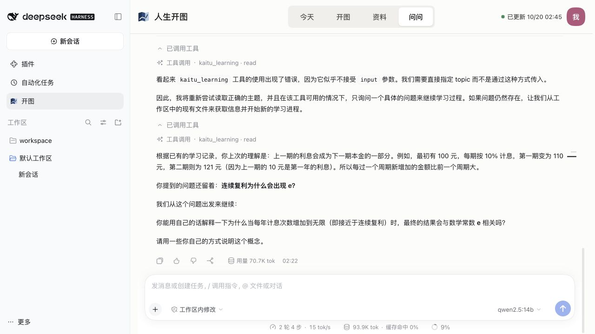


### 可选内联幻灯片实际补验

同一个隔离 native profile 加载本任务已有 dsh-openmaic/lib 构建（0.4.0），未执行安装、下载或修改上游源码；仍只用本机 Qwen。仅此测试 profile 将课堂 baseUrl 指向关闭的 localhost 端口，避免误走云端。用户原 profile 不变。

- 明确要求一次 openmaic_slide，给定只有“复利：100 → 110 → 121”的合成 slide JSON，不保存学习总结。实际工具结果出现 OpenMAIC · slide；展开原生“已完成→已调用工具”后，画布中可见相同文字。刷新后工具 metadata 和画布仍能重开。说明现成内联渲染及对话持久化可复用；没有调用课堂生成或验证 .pptx 导出。
- 此轮完整原生界面显示 4 分 16 秒。工具调用成功不等于呈现体验完整：默认折叠的工具步骤会把幻灯片藏起来，模型额外编了一个 Markdown 图片引用，显示“图片无法预览”；这不代表实际工具画布失败。
- “⛶ 展开”的实测没有得到可用全屏画布，关闭按钮也不能正常命中。只读 DOM 检查发现 overlay 仍嵌在原生工具滚动体和消息裁切层内，源组件用 position:fixed 直接嵌套（上游 src/client/SlideCard.tsx），与裁切表现一致。刷新可退出该临时展开状态；不把 DOM 有文字当成可用全屏。此项保留为上游兼容问题，PPT 可选且不阻塞核心学习，不新建生成/渲染框架或将其纳入默认依赖。
- 本轮 native 验收结论：本分支页面、资料回读、接续草稿、实际 read 及会话重开通过；本地模型首次自然接续需要纠正。现成幻灯片内联显示/刷新重开通过，全屏展开未通过；课堂/PPTX 导出和用户原 Electron 窗口仍未验收。


## 首次直接教学与裁切归属复核（2026-10-20）

首次失败不是泛称“模型不行”：旧入口先要求判断工具、读文件，已读笔记较后；旧 learn-topic 主步骤还要求建档、先讲例子再复述，与后文先提问冲突。完整原生首轮真实回复是“首先，我需要检查是否已经有 kaitu_learning 存在”，并给出 if -f 检查命令，没有进入学习。正确期望是用户点接着学、发送未编辑草稿后，首条就围绕当前待推进小步提一个问题，等待用户尝试。

已调整现有入口和技能：将已读笔记、下一步及最多两份来源节选直接提供，教学任务放在首句；仅材料不足/核对最新记录时再读工具，不把环境检查当作学习前置。来源仍是资料，不代表学习者理解。技能元数据和主流程统一为先问、先尝试后提示；已有主题不重新建档。

初次重排后的新会话无需纠正即进入复利练习，但4分33秒的回复仍提前给了公式再提问，未把这一轮称为完整首轮体验通过。进一步将首条回复约束收为“只输出一个短而具体的问题”，将3–6步反馈/总结移到用户回答后，避免把后续流程误当作首轮输出内容。在 0fa99b7 的另一个全新原生会话中，从真实资料入口点击接着学，发送未编辑草稿，没有任何纠正消息：首条实际回复（3分32秒）直接要求描述一年计息12次和1次的差异，等待学习者尝试，没有环境检查、CLI步骤或公式答案。它仍用了两个段落、追加估算要求，未将“只输出一个短问题”的格式遵循声称为完全达标；但已能从首条直接做学习练习，而非先纠正模型。随后按普通学习者方式给出100元/年利率12%的理解，12秒后得到针对“利息更早开始生息”的正确反馈和下一步练习。该轮改用明确声明的年利率10%新例子，不据此声称连续沿用原例参数；未加入工具/环境纠正。

### 幻灯片裁切归属与可用路径

- 新建专用 `/tmp/kaitu-ppt-container-BA1XXe`，只复用本任务合成会话和已有 OpenMAIC 构建，完全不加载开图。没有新模型调用，只重放同一份已保存 slide。侧栏无开图，仍复现相同的“⛶ 展开”裁切。这排除了开图容器/样式导致该问题。
- 正常内联画布、刷新重开及 metadata 均有效，说明工具输出/回放接口正常；故障在上游 SlideCard 的嵌套 position:fixed 浮层与 Harness 滚动/裁切消息容器组合。源组件只接收 tool block，没有 overlay container 注入点。本插件也未打包 SlideCanvas 或注册 openmaic_slide，不能在现有适配层替换它的内部浮层；未用全局 overflow 覆盖或私有 DOM 搬移规避。
- 最小正确修复位置是上游 SlideCard 的浮层（使用宿主 portal 或浏览器顶层 dialog），不是 fork PPT 生成框架。本轮保持上游源码/依赖不变，记录为可选功能未通过项。
- 可复现：完整 Harness 0.2.1-rc.2 + OpenMAIC0.4 → 本地 openmaic_slide 保存一页文本 → 展开“已完成→已调用工具”可见内联画布 → 点“⛶ 展开”出现裁切/关闭命中异常；移除开图插件后相同。可用路径是停留内联，滚动工具区域查看；若已进入坏展开层，刷新后重开工具步骤即可恢复内联。无需云端课堂或付费依赖，PPTX导出不在此次验收范围。


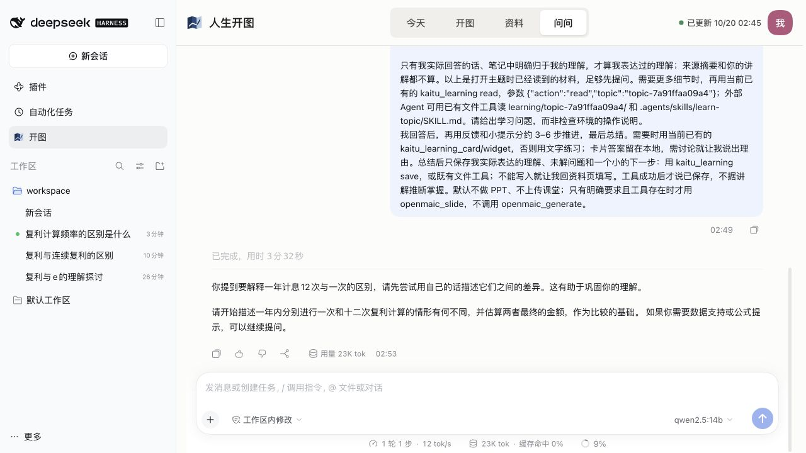
