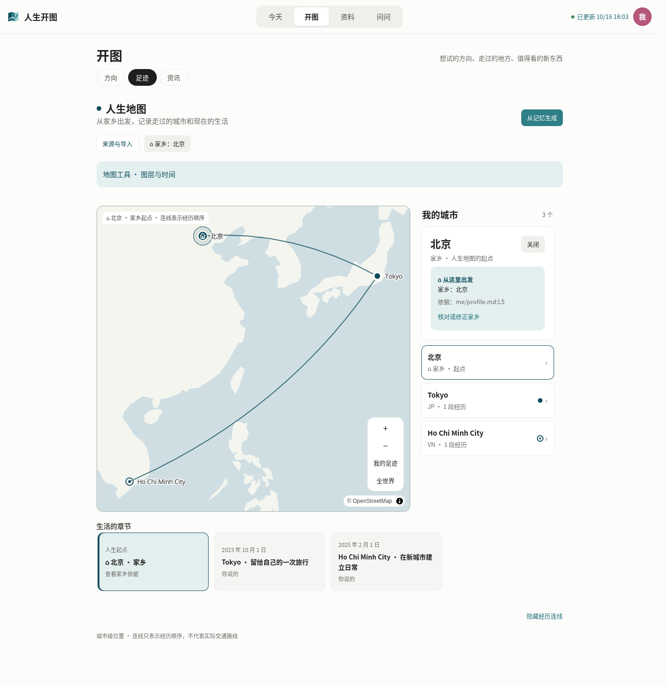
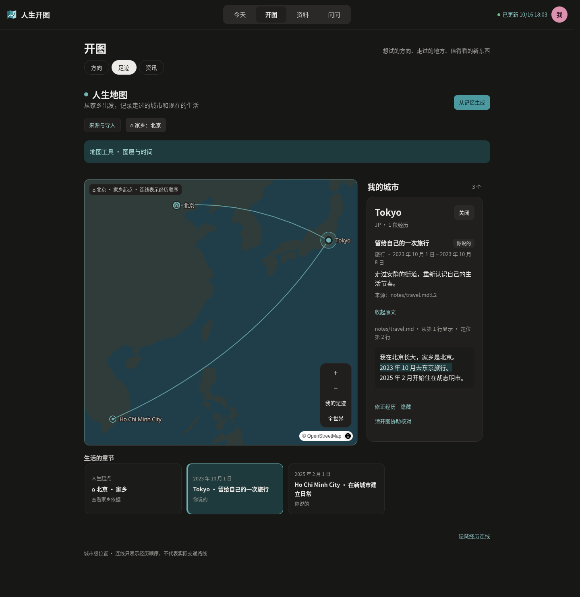
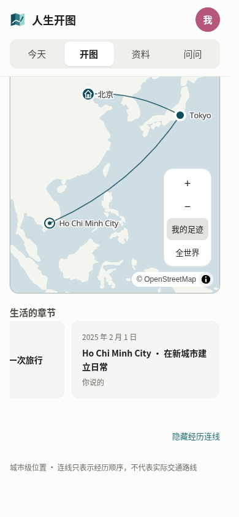

# 人生地图：家乡起点与开图视觉样式

2026-10-16，基于 `d00584f`。本次按用户确认的第二版方案实现，不改记录格式与 PRD §6。

## 用户可见变化

- 地图沿用开图青绿、字体和卡片，海陆增加对比，弱化底图普通地名。桌面右侧展示城市与经历详情，底部展示可横向浏览的经历时间轴；窄屏保留详情 sheet。
- 家乡用房屋标记作为人生主线起点；经历连线可关闭。支持返回家乡，同城多次经历仍各自保留。计划、推测、未知日期及重叠时间不被强排成已发生的路线；跨日期变更线取短边。
- 「从记忆生成」与「识别我的家乡」接入已有模型会话和 build-life-map 技能。模型从档案、记忆及对话找依据，在现有 `me/profile.md` 中维护一条 `家乡：城市名`；间接推断先用 `家乡（待核对）：城市名`。
- 地图不会把出生地、当前位置、最早城市当成家乡。缺失、地名歧义、多处家乡冲突或待核对时不指定起点，提供继续核对入口；明确家乡后展示档案依据与修正入口。
- 详情与时间轴分批显示经历，避免一次挂载大量卡片；保留来源回读、修正、隐藏/恢复、来源与批次控制、时间/图层筛选及离线城市列表。

家乡识别通过已有模型流程完成，没有新增模型服务、后台自动推断或新的持久化字段。旧工作区无需改 schema，提示词也包含档案写入格式。

## 验证

- `pnpm build`、`pnpm typecheck`、`pnpm lint`、`pnpm test`；全量测试 179 通过、2 跳过。跳过项需要 macOS DeepSeek Harness。
- 两项新增回归分别覆盖档案家乡/依据/歧义/冲突与路线起点/返乡/未知及重叠时间/跨经线。Vitest 增加 experience-time 子路径的正确源码别名，使实际客户端日期逻辑进入测试。
- Chromium 打开本分支实际独立界面及本机 HTTP 接口，使用临时工作区和合成记录。验证家乡选中、时间轴切换、来源原文回读、连线开关、深浅主题、390px 无横向溢出、详情 Escape 关闭；无页面 JS 异常。
- 2,000 条合成经历：本机 `lifeMap` 冷读 28ms，后续 9 次平均 26ms、最高 39ms；实际界面时间轴切换 88ms（含 Playwright 点击及详情可见等待）。小样本对应切换 62ms。这些是当前 Linux/软件 WebGL 环境的观测，不是所有硬件的性能保证。

在线 `tiles.openfreemap.org` 在当前云环境被网络策略拦截。浏览器验证使用真实 MapLibre WebGL 引擎，拦截瓦片样式请求并提供 Natural Earth 离线地理数据和公开的示例字体；截图验证了实际组件及样式转换，不能代替真实在线矢量瓦片、全部地名字体、生产地图服务可用性的验收。未调用真实模型或个人资料，未在 macOS 原生窗口验收。

## 实际界面截图

截图中的北京、东京与胡志明市均为合成经历；底图为上述离线测试替身。

