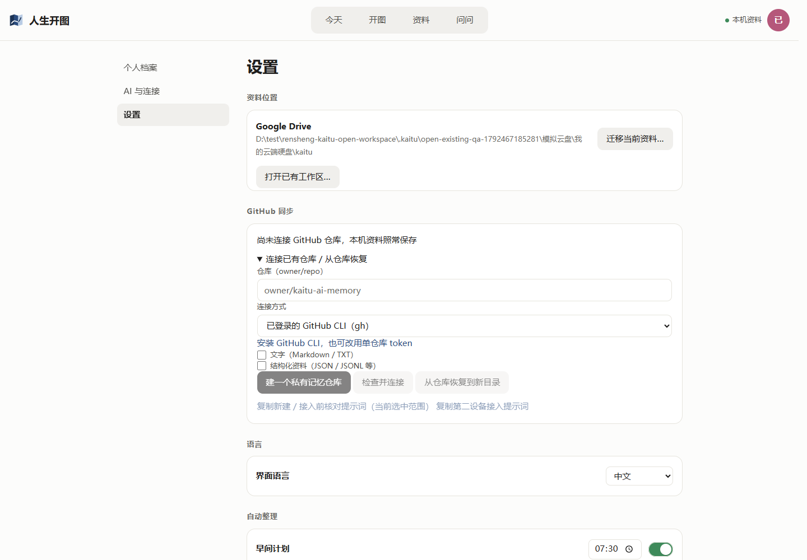

# 打开已有工作区：共用界面修复

基线：`e2d9cd83a176bf2fc6b35bc1dabe7f92f32bc9d6`。实现提交：`1fb237eb8c5763768c03e35c0ab6ba195c748c30`。

## 问题与改动

设置里的“更换本地文件夹”只有迁移语义，调用 `moveStorage` → `moveWorkspace`，已有目标被 `TARGET_EXISTS` 拒绝。用户希望打开另一台电脑已经建立的工作区，不是把当前资料迁入该目录。

共用设置页增加“打开已有工作区…”：输入路径，或直接选择已有文件夹，再点“打开此工作区”。复用已有 `workspaceBackup("activate", { root })`，继续使用宿主现有的停止监听/AI、切换、记住位置、重新绑定流程。选择路径不追加 `kaitu`。

旧入口改名为“迁移当前资料…”，防覆盖逻辑保留。没有改数据格式或新增平台后端；Mac、Windows 和插件使用同一份页面。首次引导本身尚未新增此入口，用户可先进入设置打开已有工作区。

## 已验

- `pnpm build`、`pnpm typecheck`、`pnpm lint` 通过。
- `pnpm exec vitest run packages/core/test/workspace-backup.test.ts`：7/7 通过。
- Windows 真实 Chromium 操作本分支正常 WebUI，使用隔离的 HOME、程序状态与合成资料：
  - 普通文件夹激活返回 400，当前工作区不切换，普通文件夹的合成文件保留。
  - 选择含中文、空格的 `模拟云盘/我的云端硬盘/kaitu`，选择器回传的原路径直接使用。
  - 打开已有工作区成功，原工作区与目标工作区的 profile 合成标记均保留；`currentWorkspace()` 指向目标。
  - 浏览器刷新后设置显示目标路径及 Google Drive 存放方式。
  - 再用迁移入口选择已有目录，仍显示“目标已存在，未覆盖”，当前工作区不变。

## 未验与限制

- 未读取或修改用户真实 Google Drive 资料；截图是普通磁盘中的合成云盘目录，不能作为真实虚拟盘、占位文件下载或离线行为的验证。
- Mac 真机、原生文件选择框、退出应用后重新启动未验。本轮 WebUI 重启步骤尚未完成，不将保存指针与浏览器刷新写成原生重启通过。
- 本分支未重跑全量测试，仅运行上述针对性测试；与 Windows 组合验收 PR #68 分开。
- 已有后端对普通文件夹的错误在 UI 上仍是通用“请求未完成，请检查文件格式后重试”；本次没有改错误处理或工作区迁移规则。
- 未重新打包或发布；当前用户打开的 Windows 安装包尚不包含此修复。

## 独立验收步骤

1. 隔离本机状态，新建两个合成工作区 A、B（B 路径含中文和空格），各写不同记录。
2. 从 A 的右上角进入设置，打开已有工作区，先输入普通文件夹：应拒绝，A 保持当前工作区。
3. 选择 B 的工作区根目录并打开：应沿用 B，A 的记录保留在 A，不追加目录层级。
4. 刷新，检查 B 的记录及路径；退出应用再重启，检查仍打开 B（待真机补验）。
5. 使用迁移入口选择已有 A，确认仍拒绝覆盖；验证 Mac 与 Windows 的正常目录选择均能进入同一流程。

按仓库流程交独立验收，保持草稿，不合并。
