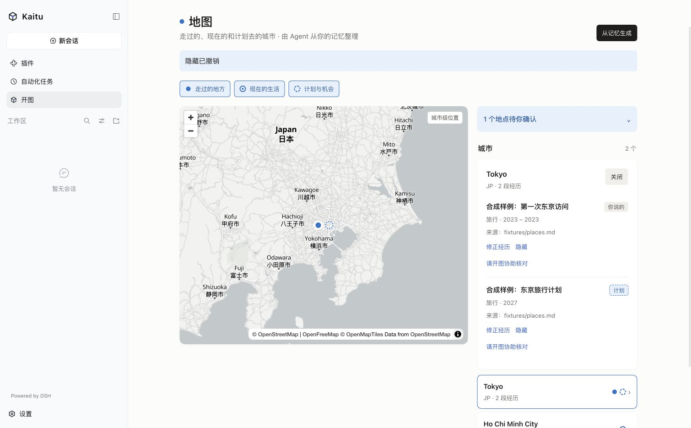
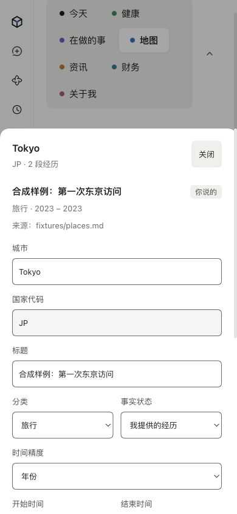
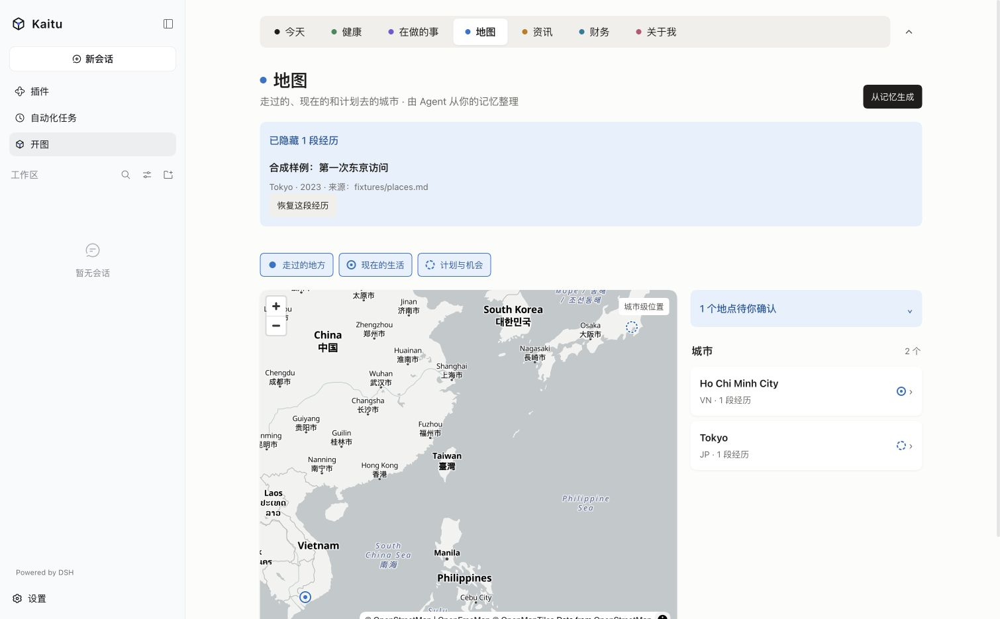

# 第 1 轮：纠错、重导保护与地图验收

日期：2026-10-16，Asia/Ho_Chi_Minh。分支：`codex/kaitu-prd-completion`。
起点：`f823b71`。本轮结果是全功能目标的一部分，总目标继续进行。

## 实现结果

1. 地点经历使用现有 JSONL 追加历史保留导入身份。改城市、改年份、隐藏后再次导入旧来源，均不新增旧经历。
2. Apple Health、ICS、Nut AI 共用的导入层按历史身份找到最新人工修订或删除，旧来源不覆盖人工处理。
3. 地图支持无模型修正城市、国家、分类、事实状态、日期精度、起止时间、标题和备注。
   坐标仍只来自城市表，来源保持原值；歧义地名保留候选并进入原有待确认入口。
4. 修正和隐藏校验预期 revision，陈旧修改返回明确冲突。隐藏可立即撤销，也能重启后从隐藏列表恢复。
5. 复用原有样式与窄屏详情面板，增加保存中、错误、成功、禁用与键盘焦点状态。

没有更改现有持久化记录格式，没有另存内容哈希或引入新依赖。

## 失败复现与修复验证

原实现：导入 2021 年胡志明市经历，再人工改为 2022 年东京，旧输入 dry-run 的 added 返回 1。
修复后：同一测试 added 为 0，记录保留人工修正。隐藏后再次导入仍为 0，同城 2025 年新访问能正常新增。
日历用例同时验证人工改期、删除、重导无改动且不新建版本。
新增测试共两个，断言实际记录和版本行为；地图用例还覆盖陈旧 revision 拒绝及隐藏恢复。

## 运行环境

| 项目 | 值 |
|---|---|
| 系统 | 本机 macOS arm64 |
| Node / pnpm | 26.11.1 / 11.22.0 |
| DSH | npm 缓存中的 0.2.0-rc.2，真实 Host 与 Remote，浏览器插件 |
| 插件 | 本工作树 `packages/dsh-plugin/dist/index.js` |
| 数据目录 | `/tmp/kaitu-prd-e2e/workspace`，只有合成样本 |
| 运行状态 | `/tmp/kaitu-prd-e2e/dsh` |
| 验收方式 | Computer Use，Chrome，默认窗口及 390×844 视口 |

测试后已关闭浏览器验收页和 DSH 进程，恢复网络拦截与视口设置。
重启命令，运行后使用输出的新本机链接：

```sh
cd /Users/yihongguo/Developer/rensheng-kaitu-prd
env DSH_HOME=/tmp/kaitu-prd-e2e/dsh \
  node /Users/yihongguo/.npm/_npx/7eff65a5cfe9d1d1/node_modules/@deepseek-ai/dsh/lib/bin.js \
  web --patch /tmp/kaitu-prd-e2e/workspace/.kaitu/cache/dsh/cordis.yml --port 19587 --no-open
```

## 端到端实测

| 操作 | 实际结果 |
|---|---|
| 未配置模型，跳过 API Key 设置进入开图 | 页面可读取已有数据与操作经历 |
| 打开东京详情 | 同一城市的 2021 年经历与 2027 年计划分开，事实状态可辨 |
| 把开始年改为 2023，结束年留 2021 | 明确显示“结束时间不能早于开始时间”，没有写入 |
| 把结束年修为 2023 并保存 | 显示保存中，再显示“修正已保存”；详情及年份筛选都变为 2023 |
| 从另一进程重放原来的 2021 年来源 | added=0；同一 id 保留 2023、revision=2、by=user |
| 隐藏该经历，再重放原来源 | added=0；东京仅剩 2027 年计划，不出现已到访层 |
| 点击撤销隐藏 | 同一 id 的 2023 年经历恢复，2027 年计划未改变 |
| 重启后读取预先隐藏的记录 | “已隐藏 1 段经历”能展开、查看修正后内容并恢复 |
| 390px 窄屏打开修正表单 | 字段按现有详情面板排列，可滚动到保存/取消，无横向溢出 |
| 屏蔽 `tiles.openfreemap.org` 并重载地图 | 显示地图加载失败；切换列表后仍可读城市、经历、来源和操作入口 |
| 最终从业务层回读并校验工作区 | hidden=0；东京过去经历 revision=6、2023；计划仍为 2027；validate=[] |








## 检查结果与下一步

`pnpm build`、`pnpm typecheck`、`pnpm lint`、`pnpm test` 均退出 0。
最终测试运行：37 个文件、118 项通过，49.87 秒。
本轮验收的是 DSH 浏览器插件；下一轮将隔离运行原生桌面包并验证相同流程。
来源目前展示文本定位符，原文查看、全局批次撤销、来源排除和其余 AC 继续按总清单推进。
