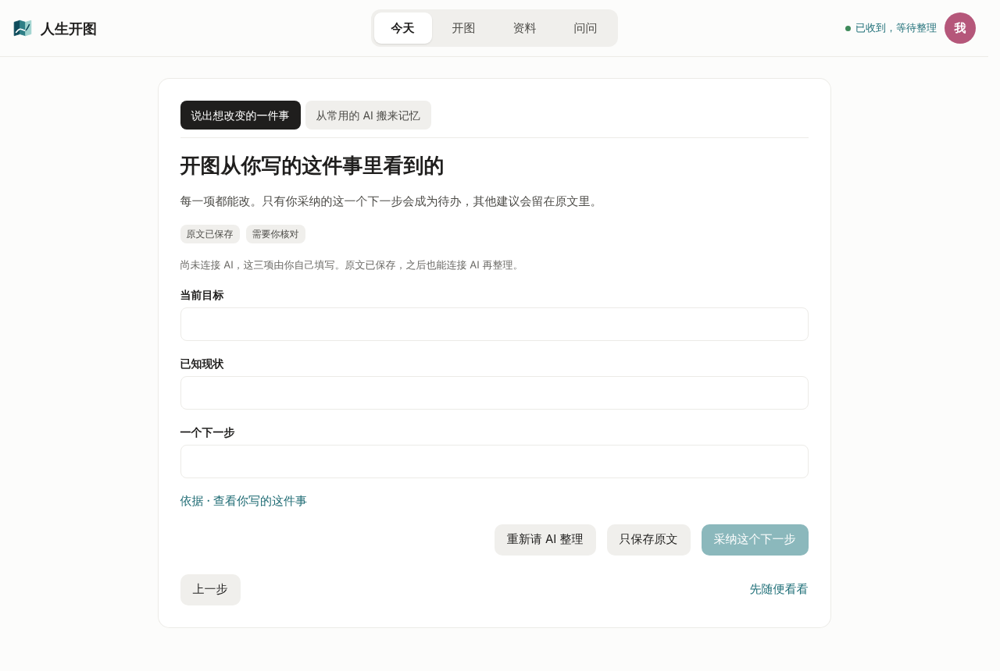
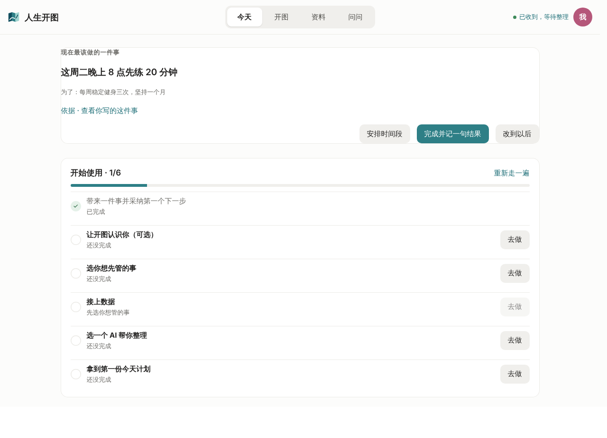
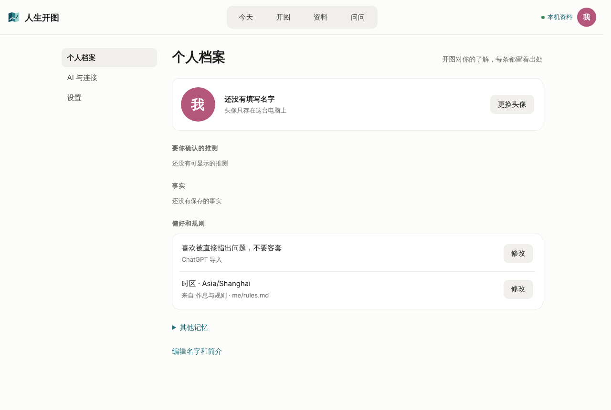
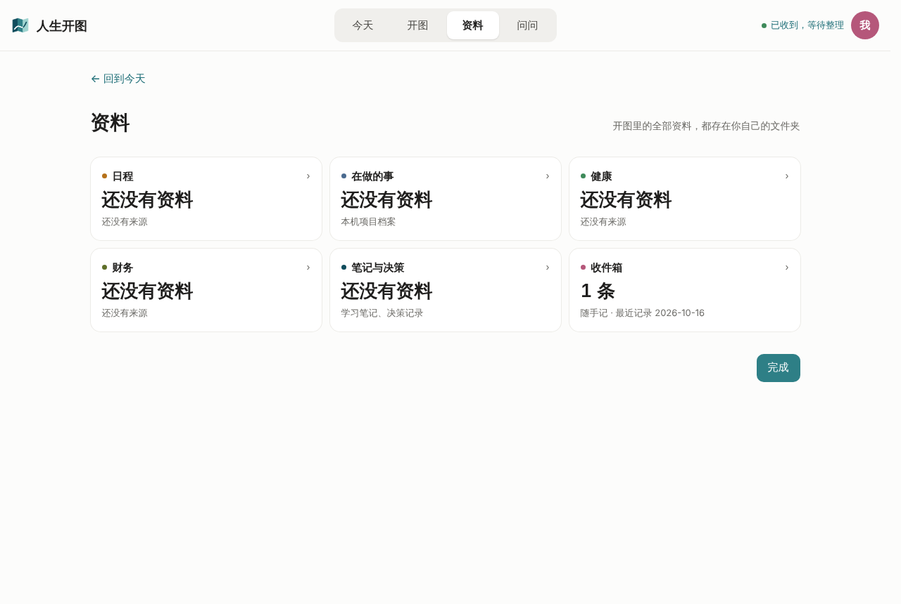

# 北极星复盘：从两类首批用户出发

- 日期：2026-10-16；对象：main `d00584f`。
- 方法：读 GOAL、PRODUCT、PRD、首发与引导 PRD、调研和交接文档；看关键代码；用 `kaitu ui` 在三个合成临时工作区里，分别以两类新用户的身份走首次使用并截图。未配置 API Key，即新用户的默认状态。
- 边界：没有运行 Kaitu.app（macOS）和真实模型，也没有真人访谈。走查用的是 Kaitu.app 与 DSH 插件共用的 React 页面。「用户会怎样」是基于走查的判断，需要 [launch §5](../prd/launch.md) 的真人观察验证。
- 本文只做分析和建议，没有改产品定义、数据规范或代码。

## 0. 结论

1. **现有北极星不对。** 「任何人都能用孙哥方法用 AI」（[GOAL.md](../GOAL.md)、[PRD §0](../PRD.md)）只对了一半：让普通人用 AI 管人生，正是 B 类要的。但它的锚点是「复制一个人的方法」，而不是两类用户的问题；「任何人」帮不了取舍；没法衡量；也完全没提 A 类的两个痛点：**记录分散在不同 AI 里**、**没有合适的可视化**。
2. **北极星指标也不对。** [PRD §13](../PRD.md) 的「从下载到第一次看到今天页，10 分钟内、不用终端」是激活指标，而且只看页面有没有出现，不看有没有用。实测搬入 10 条记忆后今天页马上就出来了，但上面没有一条内容来自这 10 条。
3. **[PRODUCT.md](../PRODUCT.md) 的产品目标最接近正确**（让 AI 持续了解你，把想改变的事变成能推进、能查回的个人进度），但有两个缺口：一是它讲的是「一件事的一个下一步」，两类人说的却是「人生规划」，中间缺「看得见全貌」这一层；二是默认不带 AI，B 类第一次用时感受不到「AI 能帮我规划」。
4. **三版北极星同时存在，旧版还在指挥开发。** [AGENTS.md](../../AGENTS.md) 要开发 Agent 先读 GOAL.md，而 GOAL.md 里还是旧北极星，还写着「PRD 1.0 全部 27 项、不缩减最终范围」，和 PRODUCT.md 的「先做减法」正好相反。结果是：财务、健康、足迹地图、资讯、手机通道、日历、GitHub 加起来约 1.5 万行，占源码约 37%；A 类最核心的「搬记忆与对话」只有约 800 行；首发 P0 的 L3「在原来的 AI 里继续」到现在还没实现。

**建议的北极星**

> 让每个会用 AI 的人，都有一张看得见、接得上、每周往前走的人生进度图。

**北极星指标：每周推进人数**，即最近 7 天里，至少在一个目标上记下真实结果（完成并记一句、调整下一步、暂停或放弃并写明原因）的用户数。在本机计算，不上传内容。

**最该先做的三件事**

1. 搬进来的规划要变成一张看得见的进度图（A）。
2. 不填 Key 也能用自己常用的 AI 来整理，同一机制顺带补上 L3（B）。
3. 状态如实，不让用户以为后台正在整理。

## 1. 两类首批用户要什么

| | A：已经在和 AI 聊人生规划 | B：会用 chatbot，不知道 AI 能规划人生 |
|---|---|---|
| 现在怎么做 | 在 ChatGPT、Claude、豆包、Kimi、DeepSeek 的不同对话里聊职业、城市、存钱、健身，结论留在各自的对话里 | 用 AI 查资料、写东西；人生的事自己琢磨，或者问一次就散了 |
| 痛点 | 分散：每家 AI 只知道一部分，换一家就得重讲一遍。看不见：不知道总共有哪些目标、做到哪了、哪些说了没做 | 没想到可以这样用；就算试过一次，也没有地方接着推进 |
| 要完成的事 | 把散落的规划汇到一处，一眼看全，下次无论用哪个 AI 都能接着聊 | 第一次就觉得「AI 真能帮我把人生的事理清楚」，然后有一个容易坚持的下一步 |
| 第一次觉得有用 | 搬进来的内容立刻按领域排成目标、在做的事、在考虑的方向，每条都标明来自哪个 AI | 用自己的话说一件想改变的事，几分钟后拿到一份靠谱的草稿：目标、现状、2–3 条路、一个小实验 |
| 回来的理由 | 每次和任何一个 AI 聊完，结果都能回到同一张图上；每周都能看到推进 | 下一步到点有提醒，做完记一句，下周能看到变化 |
| 替代做法 | 把所有东西汇总到一家 AI 里（Claude 已经能导入其他 AI 的记忆，见 [HANDOFF](../HANDOFF.md) D12）；或者用笔记软件 | 直接在豆包、Kimi 里问，免费，不用设置 |
| 最容易流失的地方 | 搬进来以后什么都看不到；回到原来的 AI 时接不上 | 要先申请 API Key；第一次用时没有 AI 帮忙 |

两类人有一个共同点：他们要的不是「把东西存起来」，而是「看见全貌，每周往前走一步」。北极星应该把这一点说清楚。

## 2. 现在有三版北极星，各有问题

### 2.1 愿景版：「任何人都能用孙哥方法用 AI」

出处：GOAL.md「北极星」一节、PRD §0。原文展开为：访谈里提到的 10 件事都能在这里完成；人只看进度、做确认，其余交给 Agent；取舍时以「是否让普通人更简单」为准。

| 检验 | 结论 |
|---|---|
| 是否以用户的问题为锚 | 否。以「复制一个人的方法」为锚，先有了解法。A 的问题是分散、看不见，B 的问题是没想到能这样用，都不是「想照某个人那样过日子」 |
| 能否帮团队说「不」 | 否。「任何人」加上「10 件事都能完成」，让每个功能都显得必要：训练组次、拍照估热量、Oura、体态照片、体检、X 动态……10 件事里直接属于人生规划的主要是档案与现状（第 1 件）、方向与决策（第 9 件）、日报与复盘（第 10 件），其余多是健康方面的自我量化（第 2–5 件）和资讯、日程管理 |
| 能否衡量 | 否 |
| 是否覆盖两类首批用户 | 只覆盖一部分。「让普通人用 AI」对应 B；A 的「多个 AI」「可视化」完全没出现。首发 PRD 已经把「完全没用过 AI 聊天的人」排除在首批之外，和「任何人」矛盾 |
| 风险 | 把一位真实公众人物的生活方式定为产品方向：他不是首批用户的共同榜样，还牵涉姓名权和 IP 风险（文档已经避免在对外场合使用） |

它也有两处值得留下。第一，「取舍时以是否让普通人更简单为准」是好的设计原则。第二，访谈里的做法，比如同一个问题问三家模型再取中间、先看 100 套房再做决定、回看过去 180 天为什么没做到、攒够 2–4 个月的资料再分析，正好是能让 B 类觉得「原来 AI 还能这样用」的内容。**建议把它从北极星降为「方法库」**，做成能直接复制给任何 AI 的提示词和示例，而不是功能清单。

### 2.2 指标版：「从下载到第一次看到今天页，10 分钟内、全程不用终端」

出处：PRD §13（第 668 行）。

- **指标类型不对。** 这是激活指标（衡量多久得到第一次价值），不是北极星指标。北极星指标应当衡量用户反复得到的核心价值，并且能预示留存。
- **只看页面出没出现，不看有没有用，空页面也能达标。** 实测 A 类搬入 10 条记忆后，今天页马上出现，「现在最该做的」写着「今天，留一点空间给下一步」，没有一条来自刚搬入的目标（见 §3.2）。指标达标了，价值却是零。
- **只照顾一类人、一家 AI。** 写死了「导入 ChatGPT 记忆」，而 B 类手里多半没有可搬的人生规划记忆。
- **「不用终端」已经起不到区分作用。** Kaitu.app 已经做到了，应该改成护栏指标。
- [首发 PRD §7](../prd/launch.md) 已经换成了更好的度量（第一次得到有用下一步的耗时、误以为已更新的次数、7 天内回来更新结果的人数），但没有升格为北极星，旧指标还留在 PRD §13。

### 2.3 产品目标版：「让 AI 持续了解你，把想改变的事变成能推进、能查回的个人进度」

出处：PRODUCT.md、[launch §1](../prd/launch.md)。三版里这一版最好：以用户得到的结果为中心，还配了一个能演示的循环（说一件事 → 核对 → 选下一步 → 记结果 → 下次接着来）。不足在于：

- **尺度对不上。** 两类人说的是「人生规划」，包括方向、几年的目标、重大选择；产品给的是「一件事的一个下一步」。从大目标到小步骤之间缺一层「看得见全貌」。这一层就是 A 说的可视化，也是「开图」这个名字的本意，而现在没有。
- **A 的两个痛点没写进去。** 没有提到「多个 AI」「汇总」「看全貌」。品牌句「AI 是可以换的，人生进度不能丢」说的是将来换 AI 时不丢东西；A 的现状却是已经同时在用好几家、东西已经散了。
- **被默认行为架空。** PRODUCT.md 规定默认不要求模型或 API Key。这保证了「能记录」，却让 B 第一次用时没有 AI。而 B 要验证的恰恰是「AI 能帮我规划」。

### 2.4 三版并存带来的后果

- AGENTS.md 要求开发 Agent 先读 GOAL.md。GOAL.md 第 30 行起的「北极星」一节还是旧版，第 18 行要求「覆盖 FR-01–FR-27……不缩减最终范围」，第 5 行却又说「先做减法」。这个仓库主要靠 Agent 开发，北极星这几行字就是开发指令。
- PRD 1.0 的 27 项功能需求中，有 11 项（约四成）和人生规划关系不大：GitHub（FR 10）、财务（FR 11–13）、健康（FR 15）、地理足迹与照片定位（FR 22–27）。
- 源码分布（不含测试，共约 4 万行）：财务约 3.5k、手机通道与采集约 3.7k、足迹地图约 2.3k、项目与 GitHub 约 1.9k、健康约 1.7k、日历约 0.9k、资讯约 0.8k，合计约 1.5 万行；而记忆与对话导入约 0.8k、引导约 2.6k、方向约 1.7k、今天页约 1.6k。
- 今天的提交还在扩充财务导入、资讯图片、手机通道和项目卡片上的 GitHub；首发 P0 的 L3「在原来的 AI 里继续」资料包，全仓库仍没有实现，[connections.ts](../../packages/dsh-plugin/src/client/connections.ts) 还是复制一条本机路径。

## 3. 实际走一遍：两类用户会遇到什么

环境：用 `kaitu init` 新建空工作区，`kaitu ui` 打开，不配置 AI（新用户的默认状态）。内容均为合成数据，没碰真实资料。

### 3.1 B 类：写下「想每周健身三次、少吃外卖，但坚持不到两周」

| # | 看到什么 | 问题 | 依据 |
|---|---|---|---|
| B1 | 点「保存并整理」后，标题是「开图从你写的这件事里看到的」，下面三栏全空，提示「尚未连接 AI，这三项由你自己填写」 | 标题说「看到了」，其实什么都没看到。B 想体验的「AI 帮我理清楚」在这一刻缺席，用户只能自己写目标、现状和下一步，而这正是他希望 AI 做的事 | [截图](north-star-2026-10-16/b-no-ai-draft.png)；[OnboardingMatter.tsx:137](../../packages/dsh-plugin/src/client/OnboardingMatter.tsx#L137)、[:210](../../packages/dsh-plugin/src/client/OnboardingMatter.tsx#L210) |
| B2 | 想用 AI 只有两条路：填 API Key（DeepSeek 等），或者选「用你已经在用的 AI」，复制一段带本机路径的说明 | 申请 API Key 通常要注册开发者平台、充值、复制密钥，对只用过网页聊天的人来说陌生，还有付费门槛；本机路径对豆包、Kimi、ChatGPT 网页版毫无用处 | [AskPage.tsx:831](../../packages/dsh-plugin/src/client/AskPage.tsx#L831)、[connections.ts](../../packages/dsh-plugin/src/client/connections.ts) |
| B3 | 点「开图 → 让 AI 提几个方向」，得到「请先在 AI 与连接中连接 AI，再来生成方向」；最适合 B 的「2–3 条可能路径」也只在连了 AI 后才出现 | 产品里最能让 B 眼前一亮的两个能力，都被 Key 挡住了 | [截图](north-star-2026-10-16/b-directions-need-ai.png)；[directions-ai.ts:30](../../packages/cli/src/ui/directions-ai.ts#L30) |
| B4 | 采纳之后，右上角一直显示「已收到，等待整理」；随手记一句话也是这样 | 没连 AI、没开自动任务，根本没有谁会去整理。launch L5 明确要求「自动整理关闭时，不显示等待后台处理」 | [截图](north-star-2026-10-16/b-today-after-adopt.png)；[OverviewPage.tsx:323](../../packages/dsh-plugin/src/client/OverviewPage.tsx#L323)、[overview-page.ts:232](../../packages/core/src/overview-page.ts#L232) |
| B5 | 今天页「现在最该做的一件事」卡片没有内边距，文字贴着边框，按钮压在边框上；下面是 6 项「开始使用」清单 | 第一次看到有用内容的画面显得没做完；清单后四项（选事情、接数据、选 AI、第一份今天计划）像配置作业，把 B 引向接数据，而不是规划人生 | 同上截图；[Onboarding.module.css:404](../../packages/dsh-plugin/src/client/Onboarding.module.css#L404) 和 `.card` 都没有设置 padding |





### 3.2 A 类：从 ChatGPT 搬 10 条记忆，再贴一段转岗对话

| # | 看到什么 | 问题 | 依据 |
|---|---|---|---|
| A1 | 预览做得很好：认出了「工作、目标、在做的事、健康、重要的人」，默认全选，格式不对的原样保留 | 这一屏让用户以为开图已经认出了他的目标和项目 | [截图](north-star-2026-10-16/a-memory-preview.png) |
| A2 | 确认后，个人档案里「事实」显示「还没有保存的事实」，只露出一条偏好，其余 9 条折叠在「其他记忆」里 | 目标、项目、健康、工作都被归成笼统的背景记忆（context），没有进入目标、项目或方向 | [截图](north-star-2026-10-16/a-profile-after-import.png)；[onboarding.ts:91–95](../../packages/core/src/onboarding.ts#L91)、[MePage.tsx:196](../../packages/dsh-plugin/src/client/MePage.tsx#L196)、[:242](../../packages/dsh-plugin/src/client/MePage.tsx#L242) |
| A3 | 「资料」页 6 张卡全是「还没有资料」；今天页「现在最该做的」是空的，「最近的变化」也是空的 | A 的第二个痛点「看不见」，搬完之后还是原样 | [截图](north-star-2026-10-16/a-records-after-import.png) |
| A4 | 想再搬 Claude 的记忆：清单里「让开图认识你」已标完成，没有按钮了；个人档案和资料页都没有「再从一个 AI 搬来」；只能点「重新走一遍」 | A 的定义就是「分散在不同 AI 里」，产品却只给一家 AI 准备了一次性入口；也没有来源对比或冲突提示（个人档案里「要你确认的推测」一直是空的） | — |
| A5 | 贴一段转岗对话后，没连 AI 时三栏还是要自己填 | 对话越长，自己提炼越累；而 A 要的正是「把聊过的东西变成进度」 | 同 B1 |
| A6 | 想回到原来的 AI 接着聊：给的是一条本机路径和「先读 AGENT-README.md」 | L3 资料包没有实现；MCP 首发只接 Claude Desktop、Claude Code、Codex 这类本机客户端；Drive 接力要先把资料搬进 Google Drive，再靠 ChatGPT、Grok 的连接器，而这些服务在中国大陆都需要特殊网络环境才能用 | [PersonalPages.tsx:263](../../packages/dsh-plugin/src/client/PersonalPages.tsx#L263) |

另外，采纳一个下一步时只写入一条待办，目标的文字存在这条待办的备注里（[onboarding.ts:1141](../../packages/core/src/onboarding.ts#L1141)）。`goals.json` 里也没有 2026-10-15 已确认的 `approach`、`review_at`、`progress` 三个字段（[goals.schema.json](../../schemas/goals.schema.json)，提案见 [2026-10-product-loop.md](../proposals/2026-10-product-loop.md)）。「目标」不是一个独立的对象，就画不出进度图，也算不出「每周往前走」。





### 3.3 已经做对、应当保留的

- 欢迎页的三步说明清楚；三个示例覆盖了三种常见状态；「只有你确认的才算数」能建立信任。
- 记忆预览很宽容：分组显示、默认全选、格式不对的原样保留。
- 原文依据随时能查；没有数据时不铺空图表，也不把未知显示成零。
- 「可能的路径」（为什么适合、还有哪些不清楚、一个小实验，且不预先选中）非常适合 B。
- 采纳后的「完成并记一句结果 / 改到以后」，已经有了闭环的雏形。

问题不在这些能力本身，而在三点：搬进来的东西没有被画出来；最有价值的能力被 Key 挡住了；回到原来 AI 的路没有打通。

## 4. 建议的北极星与指标

### 4.1 北极星

> **让每个会用 AI 的人，都有一张看得见、接得上、每周往前走的人生进度图。**

| 关键词 | 对应什么 |
|---|---|
| 会用 AI 的人 | 明确首批用户是 A 和 B，取代「任何人」，与 launch §1 一致 |
| 看得见 | 对应 A 的「没有可视化」；B 想确认「原来能这样用」，也需要一个看得见的成果 |
| 接得上 | 对应 A 的「分散在不同 AI 里」；承接品牌句「AI 是可以换的，人生进度不能丢」 |
| 每周往前走 | 对应闭环和留存，把「人生规划」落到能衡量的行为上 |
| 人生进度图 | 「开图」的本意：从全貌一直到下一步。它不是已被否定的中心节点人生树，也不算成功概率，而是按领域排列的目标卡片加一条时间线 |

取舍原则保留，措辞改为：**有冲突时，选能让用户更快看见自己的全貌、更容易往前走一步的方案。**

### 4.2 北极星指标：每周推进人数

- **定义**：最近 7 天里，至少在一个目标或方向上记下一条真实结果的用户数。真实结果包括：完成并记一句结果、调整下一步、暂停或放弃并写明原因、回顾时写下观察。AI 自动标记的、只保存了原文的、只看了页面的，都不算。暂停和放弃也算推进，这与产品「停下来是正常结果」的规则一致。
- **为什么选它**：它同时要求「有目标」（看得见）、「有下一步」（接得上）、「有结果」（往前走）；空页面、导入条数、聊天次数都刷不高它；它也能预示留存。
- **为什么不选别的**：
  - 使用时长：开图本来就应该少花维护时间。
  - 导入或记忆条数：实测搬入 10 条后首页还是空的。
  - 第一次看到今天页的时间：这是激活指标。
  - 已采纳的下一步数：只算计划，不算结果。
  - 接续次数：只覆盖 A，适合放进输入指标。
- **在本地优先的前提下怎么测**：
  - 今天页在本机显示「本周推进了几个目标」，对用户本人也是一种激励。
  - 首发期间由 5 人观察和 7 天跟进人工记录（launch §5、§6 已经安排）。
  - 之后如果需要更大规模的数据，只提供一个默认关闭、由用户主动开启的计数上报，只报数字，不含内容。

### 4.3 输入指标与护栏

| 环节 | A 类 | B 类 |
|---|---|---|
| 第一次觉得有用（激活） | 第一次打开 10 分钟内，从搬入的记忆或对话里整理出至少 1 个目标，并且在一屏内看到；第一周内资料来自 2 个以上 AI 或对话 | 第一次打开 5 分钟内拿到 AI 草稿并采纳一步；其中不用 API Key 的比例；观察中说出「以前不知道 AI 能这样用」的比例 |
| 闭环 | 采纳的下一步在 7 天内记下结果的比例 | 同左 |
| 接续 | 下一次和任何一个 AI 对话时，AI 读到最新进度、用户不用重讲的比例 | 第二次整理仍走同一条路完成的比例 |
| 留存 | 第 2 周、第 4 周仍有推进的比例 | 同左 |

护栏：误以为已保存或已连接的次数为 0；5 人中至少 4 人能说对资料去了哪里；静默覆盖和数据丢失为 0；界面 0.1 秒内有反馈、0.3 秒内返回；全程不用终端。

不追求的数字：接入的模块和数据源数、导入条数、模型调用次数、使用时长。其中导入条数和模型调用次数，PRD 1.0 §13 已经写明不作为核心指标。

## 5. 改进建议（从使用者的角度，按优先级）

建议 1–3 其实是同一个机制，可以叫「剪贴板协议」：复制提示词 → 在任意 AI 里用 → 把回答贴回来 → 宽容地解析 → 一屏核对 → 写入时带上来源。搬记忆已经用了这个机制。把它扩展成「整理一件事」和「在原来的 AI 里继续」，就能覆盖豆包、Kimi、DeepSeek、元宝、千问、ChatGPT、Claude，不需要 Key，也不需要 MCP。MCP 和 Drive 接力留给进阶用户。

### P0：让两类人第一次用就觉得有用（建议纳入首发）

**1. 搬进来就看得见（A）**

- 用户的感受：「我都告诉它我的目标了，为什么首页什么也没有？」
- 做法：
  - 在搬记忆和贴对话的预览里，`[目标]` 默认勾选「设为目标」，`[项目]` 默认勾选「建为项目」，其他条目可以手动选「放进方向」，一屏确认。
  - 搬记忆的提示词里加一个「在考虑」类别，没连 AI 也能识别出正在考虑的方向。
  - 确认后，今天页出现「你带来的规划」：按领域列出各个目标，标明来源 AI 和日期，每个目标旁边有「定下一步」按钮。
  - 个人档案把目标放在第一屏，不再折叠进「其他记忆」。
- 复用：现有的类别映射、`exploration_write` 的待采纳建议（suggested）、`goals.json`、`addTask`；不加一级导航。写入目标属于 PRD §7.5 规定要人确认的修改，一屏确认就能满足。
- 验收：搬入含 2 个目标的记忆后，不连 AI，今天页一屏内能看到这 2 个目标及其来源，并能在 3 分钟内为其中一个采纳下一步。

**2. 不填 Key 也能让 AI 整理：在你常用的 AI 里整理（B，A 也受益）**

- 用户的感受：「我天天用豆包，为什么还要去申请什么 Key？」
- 做法：没连内置 AI 时，「保存并整理」改为「复制给你的 AI → 粘贴回答」。开图生成一段带原文的整理提示词，要求 AI 按固定格式输出（`[目标]` `[现状]` `[下一步]` `[路径]` 等），用户贴回后解析成同一份草稿（包括 2–3 条路径），核对后采纳。方向页的「让 AI 提几个方向」也提供同样的复制入口。
- 好处：国内外主流 AI 都能用，不用 Key；B 在自己熟悉的 chatbot 里，第一次看到 AI 帮他规划。
- 复用：搬记忆已有的「复制提示词 → 粘贴 → 宽容解析」；草稿接口 `onboardingMatterDraft` 已经接受 goal、current、next、paths；DSH 的外部整理已经有类似的提示词。
- 验收：B 类用户不配 Key，3 分钟内拿到草稿并采纳一步；回答格式不对时原样保留，可以手改。

**3. 在原来的 AI 里继续：资料包（launch L3.1，已列为 P0，尚未实现）**

- 用户的感受：「我想回 ChatGPT 接着聊，它怎么知道我上周做了什么？」
- 做法：一键生成一份筛选过的资料包，包括当前目标、最近结果、下一步和相关原文摘录，默认不含健康诊断和财务明细；用户预览、删减后复制；AI 的回答贴回来后，走建议 2 的解析和核对。
- 验收：沿用 launch L3。资料包和建议 2 是剪贴板协议的一去一回，建议放在同一批实现。

**4. 状态如实，第一屏收尾**

- 没连 AI、也没开自动任务时，不再显示「已收到，等待整理」，改为「已保存原文」，并给出两个动作：「复制给你的 AI 整理」「自己填写」。
- 没连 AI 时，草稿页标题改为「写下你的目标和一个下一步」，不再说「开图看到的」。
- 修正「现在最该做的一件事」卡片的内边距。
- 已经采纳过的原文，不再算作「待整理」。

### P1：让人每周回来（首发后 2–4 周）

**5. 让目标成为独立的对象，落地目标行动卡。** 按 2026-10-15 已确认的提案 A，给 `goals.json` 加 `approach`、`review_at`、`progress`，给 `next` 加 `goal`；同步更新 `schemas/`、PRD §6 和 AGENTS.md 生成模板。每个目标回答五个问题：想改善什么、正在试什么、实际发生了什么、下一步是什么、什么时候回头看。

**6. 一分钟回顾，加上回来的理由。** 每周一次，或者到了 `review_at`，对每个进行中的目标问三句：发生了什么、观察到什么、继续还是调整；用户的回答直接更新下一步。日历事件备注里写「做完回开图记一句结果」（这一点已经有了）。今天页显示「本周推进」。launch §4 把一分钟回顾列为首发不做，建议首发后马上做，因为它就是推动北极星指标的那台发动机。

**7. 把多个 AI 的资料合在一起看。** 个人档案和资料页常驻「再从一个 AI 搬来」；每条资料都标明来源；不同来源的重复内容自动合并；互相矛盾的内容放进「要你确认的推测」，比如 8 月 ChatGPT 记的是「想转产品」，10 月 Claude 记的是「想读研」。贴对话时支持「我：」「Kimi：」「豆包：」等角色标记。

### P2：收窄范围，定下市场

**8. 冻结外围模块的新功能。** 财务、足迹地图、资讯、手机通道、邮件与聊天采集、GitHub CI 保留现有能力，默认收起；在每周推进人数有起色之前，不再加新功能。同时修改 GOAL.md 第 18 行的「不缩减最终范围」。这些模块也是性能问题和安全风险的主要来源：用户反馈过「整个 App 都很慢」，也已经做过两轮安全审查。

**9. 定下国内还是海外（PRD §14 的待定项）。** 界面是中文、默认用 DeepSeek、支持微信和支付宝账单，说明首批用户在国内；但接续却依赖 Claude、Codex、Grok、ChatGPT 和 Google Drive。建议国内优先：接续以剪贴板协议为主，云端存放选 iCloud，MCP 和 Drive 接力作为进阶选项。

**10. 让 B 在产品之外先开窍。** 把访谈里的方法做成可以分享的提示词，比如「把你的人生规划画成一张进度图」：在任何 chatbot 里都能用，输出的格式开图能直接导入。「先随便看看」应该展示一张明确标注为示例的进度图，而不是一个空应用。

### 不建议做

- 首发提供托管的免费 AI 额度：有成本，会多出一个数据接收方，也和「完全免费、本地优先」冲突。先用剪贴板协议。
- 新增一级导航、中心节点人生树、成功概率：这些都已经被否定过。
- 用导入条数、接入的数据源数来衡量进展。

## 6. 需要你拍板

1. 是否采用 §4 的北极星和「每周推进人数」。如果采用，只在 PRODUCT.md 里保留一份；GOAL.md 的「北极星」一节、PRD §0 和 §13 改为引用它。
2. 建议 1–4 是否纳入首发 P0，并与 L3、L5 合成一批来做。
3. 搬入资料时写入目标，是否接受「一屏确认」（符合 P4「先建议、后确认」）；目标行动卡的字段改动已经确认过，什么时候落地。
4. 首批市场是国内优先，还是国内外并行。
5. 首发后是否提供一个默认关闭的匿名计数上报，用来衡量北极星指标。

## 附：如何复现这次走查

```bash
pnpm install && pnpm build
HOME=/tmp/kaitu-home node packages/cli/dist/main.js init /tmp/kaitu-a --timezone Asia/Shanghai
HOME=/tmp/kaitu-home KAITU_LOCAL_STATE_DIR=/tmp/kaitu-a-state \
  node packages/cli/dist/main.js ui --no-open --dir /tmp/kaitu-a
```

- A 类：开始 → 从常用的 AI 搬来记忆 → 粘贴含 `[目标]` `[项目]` 的回答 → 记下 → 依次看今天、个人档案和资料。
- B 类：开始 → 写一件想改变的事 → 保存并整理 → 看草稿页、右上角状态和今天页；再试「开图 → 让 AI 提几个方向」。
